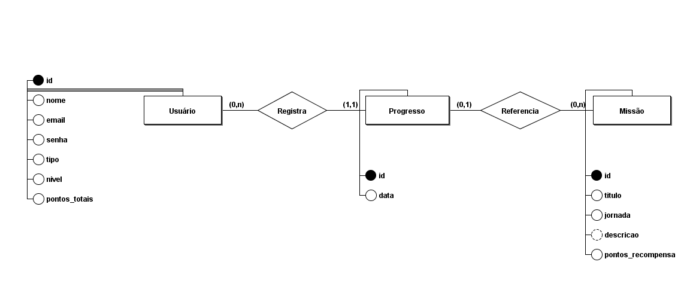

# Diagrama entidade-relacionamento

[Arquivo editável do brModelo](brmodelo/Nexa-Quest-Conceitual.brM3)

O usuário pode registrar várias conclusões. Cada conclusão pertence a um usuário e pode manter o histórico quando a missão associada é excluída.
